  

  
  
  

I build ML and LLM systems and test every one on data it hasn't seen. MSc Data Science & AI at the University of
Liverpool; before that, ML extraction at Filed (F1 0.94 on 200+ tax files a day) and Python data pipelines at DHL
(250+ hours of manual work saved a month). I publish the results that go against me too: ablations, leakage I found,
baselines that won.

### Featured projects

  
  
  
  
  
  

**More:** [finrisk-service](https://github.com/ChrishA-tech/finrisk-service) ·
[insurance-ops-automation](https://github.com/ChrishA-tech/insurance-ops-automation) ·
[bending-spoons-financial-analysis](https://github.com/ChrishA-tech/bending-spoons-financial-analysis) ·
[oil-price-forecasting](https://github.com/ChrishA-tech/oil-price-forecasting) ·
[model-grid](https://chrisha-tech.github.io/model-grid/) ·
[leetforge](https://github.com/ChrishA-tech/leetforge)

### Stack

Open to AI Engineer, Machine Learning Engineer and Data Scientist roles in the UK.

